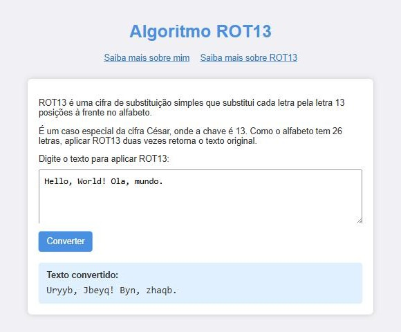

# ROT13 com Flask

[](https://github.com/rafaelholder/rot13-flask/actions/workflows/tests.yml)

Aplicação web em **Flask** que aplica a cifra **ROT13**, uma variação da cifra de César, ao texto digitado pelo usuário.

<p align="center">
  
</p>

## O que é ROT13?

ROT13 (*rotate by 13 places*) troca cada letra pela letra 13 posições à frente no alfabeto: **A** vira **N**, **B** vira **O**, e assim por diante. Como o alfabeto tem 26 letras, aplicar ROT13 duas vezes devolve o texto original, então a mesma função cifra e decifra.

ROT13 não protege nada: serve para esconder spoilers e para estudar cifras de substituição.

## Funcionalidades

- Converte maiúsculas e minúsculas e mantém números, pontuação e acentos
- Mostra o texto convertido logo abaixo do formulário
- Interface responsiva em HTML e CSS, sem JavaScript

## Cuidados de segurança

| Prática | Onde |
| --- | --- |
| Texto do usuário escapado pelo Jinja2, então HTML enviado no formulário não é executado (XSS) | `templates/index.html` |
| Modo debug desligado por padrão; só liga com `FLASK_DEBUG=1`, porque ele expõe um console interativo | `app.py` |
| Limite de tamanho da requisição (`MAX_CONTENT_LENGTH`) e do texto convertido | `app.py` |
| Links externos com `rel="noopener noreferrer"` | `templates/index.html` |

## Estrutura

```
.
├── app.py               # rota e função rot13
├── templates/index.html
├── static/style.css
└── tests/test_app.py    # testes com pytest
```

## Como rodar

```bash
git clone https://github.com/rafaelholder/rot13-flask.git
cd rot13-flask
python -m venv .venv
source .venv/bin/activate        # no Windows: .venv\Scripts\activate
pip install -r requirements.txt
python app.py
```

Abra http://127.0.0.1:5000/ no navegador.

Para servir em produção (Linux), use o gunicorn, que já está no `requirements.txt`:

```bash
gunicorn app:app
```

## Testes

```bash
pip install -r requirements-dev.txt
pytest
```

Os testes cobrem a cifra, a página, o formulário, o escape de HTML e os limites de tamanho. Eles rodam a cada push pelo GitHub Actions.
